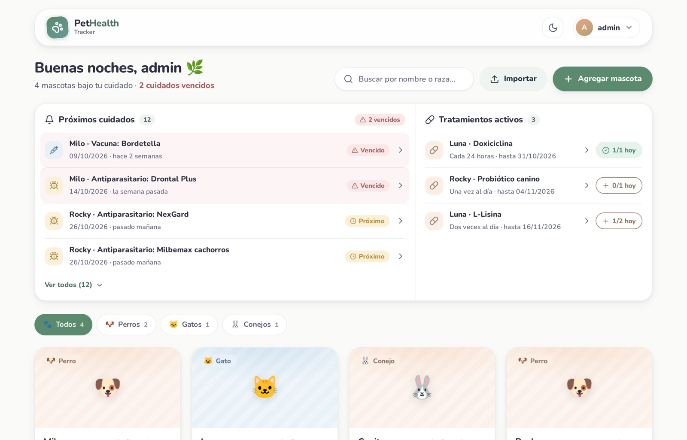
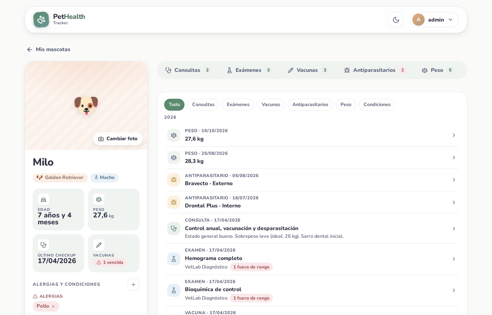
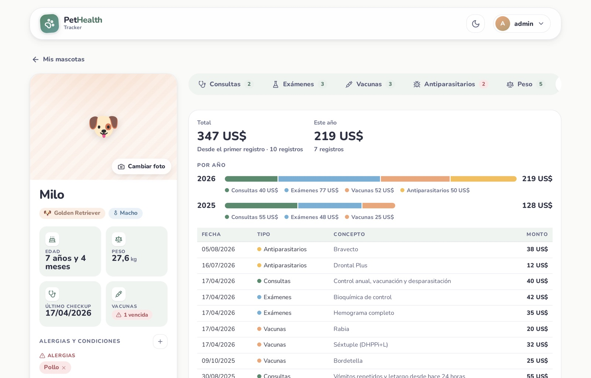
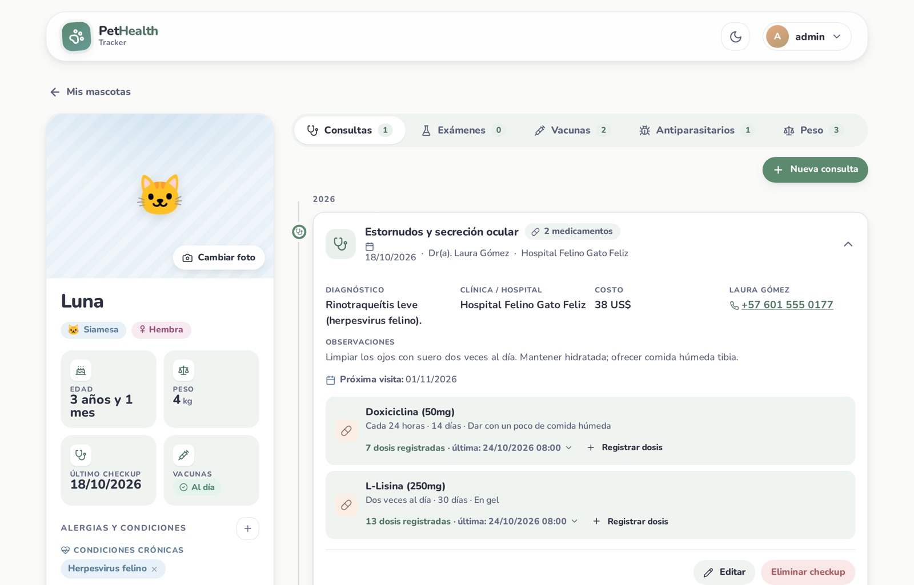
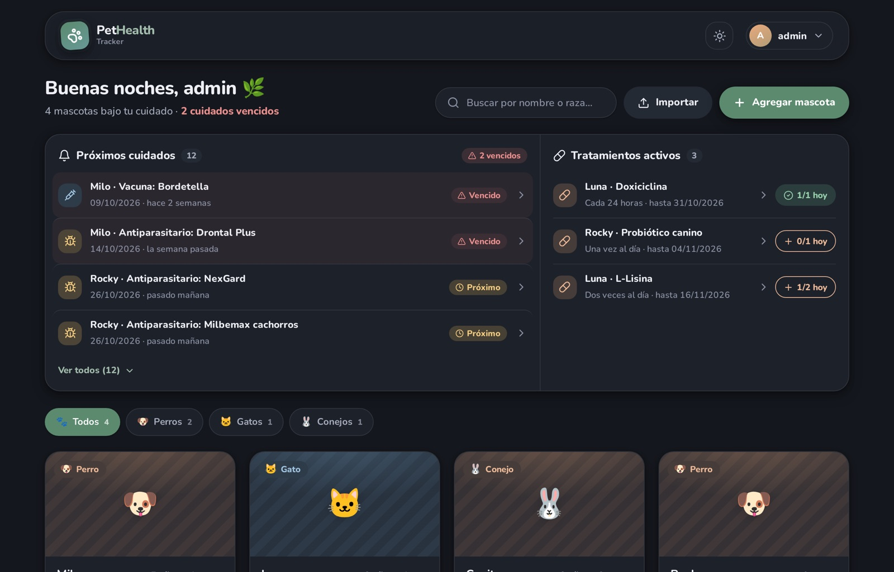
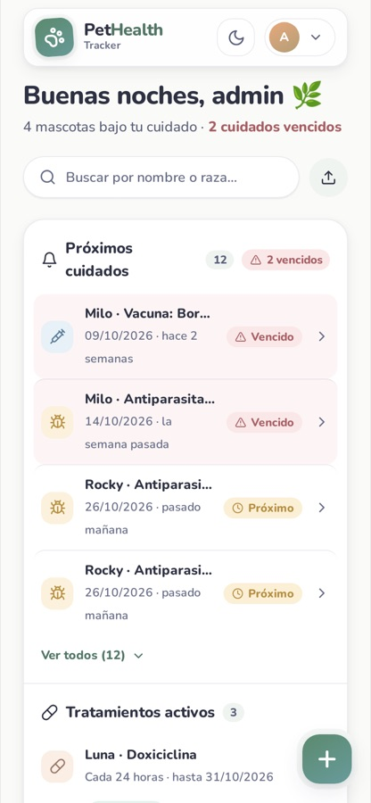

# PetHealth Tracker 🐾

[](https://github.com/chmedinap/pethealth/actions/workflows/ci.yml)
[](https://hub.docker.com/r/martitoci/pethealth)
[](https://hub.docker.com/r/martitoci/pethealth)

**A self-hosted medical record for your pets.** Keep vet visits, prescriptions, lab results, vaccines, parasite treatments, weight and expenses in one place, and get reminded before anything is due — by email or right in your calendar.

One Docker container, one SQLite file, no cloud account. Spanish and English interface, light and dark mode, works on your phone.



---

## Contents

- [Features](#features)
- [Screenshots](#screenshots)
- [Quick start](#quick-start)
- [Configuration](#configuration)
- [Email reminders](#email-reminders)
- [Calendar subscription](#calendar-subscription)
- [Reverse proxy (HTTPS)](#reverse-proxy-https)
- [Backups, upgrades and data](#backups-upgrades-and-data)
- [Security](#security)
- [Development](#development)
- [Project structure](#project-structure)
- [API](#api)

---

## Features

### Health record
- **Vet checkups** — reason, diagnosis, observations, next visit, prescribed medications and up to 3 attachments (PDF or images)
- **Lab exams** — values with units and reference ranges, PDF report, and a **trend chart** for any parameter measured more than once
- **Vaccines** — doses and boosters with status: up to date, due soon or overdue
- **Parasite control** — internal, external and combined treatments, with one-click "next dose in 1 / 3 / 6 months"
- **Allergies & chronic conditions** — shown at the top of the profile, in the shareable summary and in the printable report
- **Weight history** — chart and log; the current weight is always the latest entry
- **Timeline** — every record of a pet in one chronological view, filterable by type

### Day-to-day care
- **Upcoming care** on the dashboard — overdue and upcoming visits, vaccine boosters and parasite treatments across all your pets
- **Dose tracking** — tap to log each dose of an active treatment (who gave it and when). The daily target comes from the prescription: "every 8 hours" → 3 a day
- **Email reminders** — a digest when something is due in 7 days, tomorrow or today, or has been overdue for 3 days
- **Calendar feed** — a private `.ics` link for Google Calendar, Apple Calendar or Outlook, with an alert the day before

### Organisation
- **Expenses** — optional cost on checkups, exams, vaccines and parasite treatments; totals per pet, per year and per category, in your currency
- **Vet directory** — your vets and clinics with phone, email and address; autocompletes forms and can be built from your history
- **Printable report** — the full medical history, ready to "Save as PDF" for a new vet
- **Shareable summary** — a plain-text health summary to send by WhatsApp or email
- **Export / import** — move a pet with its whole history and files to another account or installation as a ZIP

### Multi-user & self-hosting
- **Sharing** — give family members or a pet sitter view-only or edit access to a pet
- **Any species** — dogs, cats, birds, rabbits, rodents, ferrets, reptiles, fish, horses…
- **Account security** — forced change of the default password, login rate limiting, "sign out of other devices"
- **Automatic backups** — consistent SQLite snapshots with rotation
- **Demo data** — a fresh install comes with 4 example pets so you can explore everything right away

---

## Screenshots

| Pet timeline | Expenses |
|---|---|
|  |  |

| Checkup with dose log | Dark mode |
|---|---|
|  |  |

<p align="center"></p>

---

## Quick start

You only need [Docker](https://docs.docker.com/get-docker/).

### Docker Compose (recommended)

Create a folder with this `docker-compose.yml`:

```yaml
services:
  pethealth:
    image: martitoci/pethealth:latest
    container_name: pethealth
    restart: unless-stopped
    ports:
      - "3000:3001"
    volumes:
      - ./data:/app/data
    env_file: .env
```

and a `.env` next to it (see [.env.example](.env.example) for every option):

```bash
echo "JWT_SECRET=$(openssl rand -hex 32)" > .env
echo "TZ=America/Bogota" >> .env
docker compose up -d
```

Open **http://localhost:3000** and sign in with **admin / admin123**. You'll be asked to choose a new password before anything else.

### docker run

```bash
docker run -d --name pethealth --restart unless-stopped \
  -p 3000:3001 \
  -e JWT_SECRET="$(openssl rand -hex 32)" \
  -e TZ=America/Bogota \
  -v "$(pwd)/data:/app/data" \
  martitoci/pethealth:latest
```

### Build from source

```bash
git clone https://github.com/chmedinap/pethealth.git
cd pethealth
cp .env.example .env    # then set JWT_SECRET
docker compose up --build -d
```

> **Demo data.** The first start creates 4 example pets — Milo, Luna, Copito and Rocky — with dates relative to that day, so reminders, treatments and charts all have something to show. Delete them when you're done, or set `SEED_DEMO=false` before the first start to begin empty.

---

## Configuration

All settings are environment variables. Only `JWT_SECRET` is required.

| Variable | Default | Description |
|---|---|---|
| `JWT_SECRET` | — | **Required.** Secret for signing sessions. Generate with `openssl rand -hex 32`; the server won't start without it |
| `TZ` | `UTC` | Server time zone, e.g. `America/Bogota`. Affects "today" for reminders and emails |
| `ALLOW_REGISTRATION` | `false` | `true` shows a sign-up option on the login screen |
| `SEED_DEMO` | `true` | Create the 4 demo pets on the very first start |
| `APP_URL` | — | Public URL of the app (e.g. `https://pets.example.com`), used for links in emails and calendar events |
| `TRUST_PROXY` | `false` | Set to `true` behind a reverse proxy (secure cookies and real client IP) |
| `LOGIN_RATE_LIMIT` | `10` | Failed login attempts allowed per IP every 15 minutes (`0` disables) |
| `BACKUP_INTERVAL_HOURS` | `24` | Hours between automatic database backups (`0` disables) |
| `BACKUP_KEEP` | `7` | Number of backups to keep |
| `SMTP_HOST` | — | SMTP server for email reminders. Without it, email is off |
| `SMTP_PORT` | `587` | SMTP port |
| `SMTP_SECURE` | `false` | `true` for implicit TLS (usually port 465) |
| `SMTP_USER` / `SMTP_PASS` | — | SMTP credentials |
| `SMTP_FROM` | `SMTP_USER` | Sender, e.g. `PetHealth <pets@example.com>` |
| `NOTIFY_HOUR` | `8` | Local hour (0–23) from which the daily digest is sent |
| `PORT` | `3001` | Port inside the container |
| `DATA_DIR` | `/app/data` | Where the database, uploads and backups live |

Per-user preferences — currency, language, notification email and calendar link — are set in the app under **My account**.

---

## Email reminders

1. Add SMTP settings to `.env` and restart the container. For example, with Gmail (requires an [app password](https://myaccount.google.com/apppasswords)):

   ```env
   SMTP_HOST=smtp.gmail.com
   SMTP_PORT=465
   SMTP_SECURE=true
   SMTP_USER=you@gmail.com
   SMTP_PASS=your-app-password
   SMTP_FROM=PetHealth <you@gmail.com>
   APP_URL=https://pets.example.com
   ```

2. In **My account → Email reminders**, enter your address, tick the box and save. Use **Send test email** to check the setup.

The server checks every hour and sends at most one email per user per day, after `NOTIFY_HOUR`. An email goes out only on days when something is due in 7 days, tomorrow or today, or has been overdue for 3 days, so you aren't sent the same reminder every day. Each email lists everything that is overdue or coming up in the next week, plus ongoing treatments, in the user's language.

---

## Calendar subscription

In **My account → Calendar**, create your private link and add it to your calendar app:

- **Google Calendar:** *Other calendars → + → From URL*, paste the link
- **Apple Calendar / Outlook:** use **Open in my calendar**, or subscribe to the URL manually

The feed includes next vet visits, vaccine boosters, parasite treatments and ongoing medications for all the pets you can see, with an alert the day before. Calendar apps refresh it on their own schedule (Google can take several hours).

The link works without signing in, which is why it's random and long. If it leaks, use **Change link** to invalidate the old one.

---

## Reverse proxy (HTTPS)

Set `TRUST_PROXY=true` and `APP_URL`, then proxy to port 3001. nginx example:

```nginx
server {
    server_name pets.example.com;
    client_max_body_size 200m;   # pet imports can be large; uploads are 5–15 MB

    location / {
        proxy_pass http://pethealth:3001;
        proxy_set_header Host              $host;
        proxy_set_header X-Real-IP         $remote_addr;
        proxy_set_header X-Forwarded-For   $proxy_add_x_forwarded_for;
        proxy_set_header X-Forwarded-Proto $scheme;
    }
}
```

Caddy: `pets.example.com { reverse_proxy pethealth:3001 }`.

---

## Backups, upgrades and data

Everything lives in the mounted `data/` folder:

```
data/
├── pethealth.db       # SQLite database
├── backups/           # automatic snapshots (pethealth-YYYYMMDD-HHMMSS-mmm.db)
└── uploads/           # photos/, pdfs/, attachments/
```

- **Backups.** The server keeps `BACKUP_KEEP` consistent snapshots in `data/backups/`, taken with SQLite's online backup API, which is safe while the app runs. Take one manually with `docker exec pethealth npm run backup`. Uploaded files never change once written, so copying the whole `data/` folder is a full backup.
- **Restore.** Stop the container, put the folder back (or copy a snapshot over `pethealth.db`) and start it again.
- **Upgrade.** `docker compose pull && docker compose up -d`. Schema changes are applied automatically on startup through versioned migrations (`PRAGMA user_version`).
- **Moving a single pet.** Use *Export pet (ZIP)* on its profile and *Import* on the dashboard of the other account or installation.

---

## Security

- Change the default **admin / admin123** password. The app blocks everything else until you do.
- Never commit `.env`. Use a long random `JWT_SECRET`.
- Passwords are hashed with bcrypt, and new passwords need at least 8 characters. Failed logins are rate-limited per IP.
- Changing your password signs out every other session. *My account → Sign out of all other devices* does the same on demand.
- Every record is scoped to the pets a user owns or was given access to. Other users' records answer `404`.
- Uploads are restricted by type and size, stored under random names and only served to users with access to the pet. Imported files are checked by content, not by name.
- Keep the instance behind HTTPS if it's reachable from the internet, and leave `ALLOW_REGISTRATION=false` unless you want anyone to be able to sign up.

---

## Development

Requires Node.js 20+.

```bash
# Terminal 1 — API on :3001 (data in backend/data)
cd backend && npm install
JWT_SECRET=dev ALLOW_REGISTRATION=true npm run dev

# Terminal 2 — UI on :5173, proxies /api and /uploads to the API
cd frontend && npm install && npm run dev
```

### Tests

```bash
cd backend && npm test    # API: access control, sharing, doses, parasites, calendar, email, export/import, migrations…
cd frontend && npm test   # utils: dates, money, dose frequency, expenses, timeline, lab parsing, chart ticks
```

GitHub Actions ([ci.yml](.github/workflows/ci.yml)) runs both suites, the production build and a Docker smoke test on every push and pull request.

### Publishing the image

Build for `linux/amd64` (most servers), even from an Apple Silicon Mac:

```bash
docker buildx build --platform linux/amd64 -t martitoci/pethealth:latest --push .
```

### Tech stack

| Layer | Technology |
|---|---|
| Frontend | React 18, Vite, React Router, Axios, Lucide icons |
| Backend | Node.js 20, Express, better-sqlite3 |
| Auth | JWT + bcrypt; httpOnly cookie for file access |
| Email / calendar | nodemailer, iCalendar (RFC 5545) feed |
| Files | Multer uploads, adm-zip for pet export/import |
| Packaging | One multi-stage Docker image: the built frontend is served by Express |

---

## Project structure

```
pethealth/
├── Dockerfile               # multi-stage: build frontend → serve with Express
├── docker-compose.yml       # build-from-source setup
├── .env.example
├── docs/                    # API reference, screenshots
├── backend/
│   ├── src/
│   │   ├── app.js           # Express app and routing
│   │   ├── db.js            # schema, migrations, triggers
│   │   ├── seed.js          # demo pets
│   │   ├── access.js        # owner / editor / viewer per pet
│   │   ├── reminders.js     # due items shared by dashboard, email and calendar
│   │   ├── notify.js        # daily email digest
│   │   ├── ics.js           # calendar feed
│   │   ├── backup.js        # scheduled SQLite backups
│   │   └── routes/          # one file per resource
│   └── test/                # node:test + supertest
└── frontend/
    └── src/
        ├── pages/           # Dashboard, PetProfile, PetReport, Account, Vets, forms…
        ├── components/      # cards, panels, lists, charts
        ├── utils/           # pure helpers (+ Vitest tests)
        └── translations.js  # ES / EN strings
```

---

## API

PetHealth has a JSON REST API (the same one the UI uses), authenticated with a Bearer token from `POST /api/auth/login`. See **[docs/API.md](docs/API.md)** for every endpoint.

---

Made with 🐶🐱🐰 for the ones who can't tell us where it hurts.
